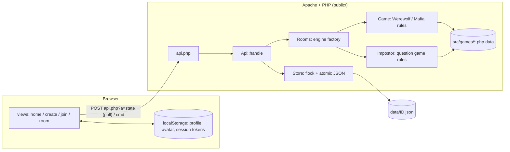

# Architecture

> Maintained by the `documenter` agent together with `docs/code.md`.

## Purpose and scope
Three games, played from any browser (phone-first). A host creates a game, picks how many of each character, shares a code / QR link, and when the host starts (4+ players, seats need not all be filled) the server deals the character cards and acts as moderator. **Werewolf** and **Mafia** are turn-based social-deduction games run by the classic engine (`Game`); **Impostor** is a party game of similar questions run by its own engine (`Impostor`). Rules: [`rules.md`](rules.md).

Out of scope: accounts, spectators, persistence beyond a week, i18n.

## Confirmed stack
| Concern | Decision |
|---|---|
| Server language | **PHP ≥ 8.2**, plain (no framework), `declare(strict_types=1)`, namespace `Wm` |
| Target hosting | **Apache shared hosting** (Apache + PHP-FPM, no long-running processes, no WebSockets) |
| Dependencies | **None at runtime.** `composer.json` only declares PSR-4 autoload and scripts; `src/bootstrap.php` has an equivalent autoloader so `composer install` is not required on the server |
| Database | **None.** One JSON file per game (see *Storage*); chosen over MySQL because games are short-lived and file locking is enough. Can be swapped by re-implementing `Store` |
| Frontend | Vanilla JS ES modules, no build step; `qrcode-generator` (MIT) vendored in `public/js/vendor/` |
| Realtime | **Short polling** (1.2–5 s) of `api.php?a=state`, version-based |
| Tests | Dependency-free runner: `php tests/run.php` |

## High-level design


Layers:
- **Entry** `public/api.php` – reads the request, calls `Api`, writes JSON.
- **API** `src/Api.php` – a pure `handle(action, input) → [status, payload]`, so tests call it without HTTP.
- **Domain** one engine per game family, both implementing the `Room` interface: `src/Game.php` (+ `Config`) for Werewolf/Mafia and `src/Impostor.php` (+ `ImpostorConfig`, trait `RoomBase`) for Impostor; shared `Player`, `GameError`. `Rooms` picks the engine from the game definition. `src/games/*.php` are data-only game definitions registered in `src/Games.php`.
- **Persistence** `src/Store.php` (works against `Room`) – locking, atomic writes, id validation, sweeping.
- **Client** `public/js` – router, views, polling.

## Request lifecycle
1. **Create** – `create`: validate (`Config::normalize`, `Config::profile`), allocate a 6-char id (alphabet without look-alikes) by exclusively creating `data/ID.json`, add the creator as host player, return `{id, playerId, token}`.
2. **Join** – the QR / link opens `?join=ID`; `join` adds a player (lobby or day 0 via `Game::joinable`, names unique, seats limited) and returns a secret `token`. The token is the only credential and is saved in `localStorage` so a refresh resumes the seat.
3. **Play** – the client polls `state {id, token, v}`; if nothing changed the server answers `{unchanged:true}` without taking a lock. Commands are sent with `cmd` and answered with the fresh state.
4. **End** – a win condition sets phase `ended` and reveals all roles. `Game::endedAt` is set. Retention: an ended game is deleted 2 days after it ended, any other 7 days after its last write (`Store::expired`); an expired game answers "Game not found" (`peekLive` hides it, `discard` deletes it under the lock). `Store::sweep` runs on `create` and on about 1 in 20 `info` calls. There is no list-games API; the home shows only sessions stored in the browser.

### Lazy timers
There is no background process, so phase deadlines are absolute timestamps (`Game::$deadline`, ms). `Game::tick()` is called at the start of every locked request and advances expired phases (night actions missing → skipped, discussion → vote, vote → resolved, …). Consequence: if nobody polls, time effectively stands still; the first poll catches up one phase at a time (each new phase gets a fresh full timer).

### Versions and presence
Every visible change bumps `Game::$version`. A poll with the current version is answered from a lock-free read. Each poll also refreshes the player's `lastSeen` (at most every 5 s via the locked path); players unseen for 15 s are shown as disconnected.

## Storage
- `data/<ID>.json` – the whole game (settings, players incl. tokens and avatars, log, chat, night state). `data/<ID>.lock` – lock file.
- **Writers** take `flock(LOCK_EX)` on the lock file, load, `tick()`, apply the change, write a temp file and `rename()` it over the game file (atomic).
- **Readers** (`Store::peek`, `peekLive`) are lock-free and always see a complete file; polling an ended game takes no lock. Lock files are handled by the private `Store::lock()` helper.
- The directory is configured in `config/config.php` (`data_dir`; override in `config/config.local.php` or `WM_DATA_DIR`). It must be writable and, ideally, outside the web root; `data/.htaccess` denies access when inside it.
- `pool` holds role cards not dealt at start (late joiners draw from it). It is persisted but never in a view. Saves without `pool`/`profileAt` still load (late joiners then get a filler).
- Role/game definitions are code, not data.

## Game engine (`src/Game.php`)
```
lobby ─start→ discussion(day 0) ─→ night ─→ [hunter] ─→ discussion ─→ vote ─→ [hunter] ─→ night … ─→ ended
```
- The evil kill is a suggest-and-confirm flow: `action{target}` sets a suggestion (and clears confirmations), `action{confirm:true}` confirms once all living killers suggest the same player (`agreedTarget`); timeout/skip picks randomly among distinct suggestions. Paladins share charges and need all living paladins to save; a Hunter shooting a Hunter is held in the persisted `heldLog` and flushed later (never in views).
- Ghost is a hidden trait (`ghostSlot` in player state) dealt to living non-evil players, as many as the host setting `ghosts` (0..number of werewolves; clamped to wolves dealt/candidates, topped up on early start and late join; `hauntSpec` reads it). `ghosts` is null in old saves: existing slots are kept, none assigned (old lobby saves start without ghosts; editing settings sets 0). A ghost rises only from night deaths (wolf kill or poison, unless saved). The legacy `ghost` role flag stays for old saves.
- Night has three steps (role `night.step`, default 1): step 1 all actors in parallel; step 2 roles that see the evil team's victim (Witch, Paladin); step 3 ghosts raised by this night's deaths (`haunt`). `applyNightEffects` runs once between steps 2 and 3 (blocks → victim/guard/heal/poison/shot attacks → protection → inspections → dying list and ghost creation); `finishNight` announces deaths, marks ghost targets (`Game::marks`, public for the day) and kills. Steps without actors are skipped.
- Start: `composition(n)` splits the configured cards into dealt and hidden pool (see `rules.md`); late joiners get `drawLateRole`. Discussion/vote timers are optional (0 = no deadline); the night timer is mandatory (30–90 s per step, default 60; old saves are normalised); the host can always `skip` discussion, vote, night steps and the hunter shot.
- Role flags beyond the basics: `allegiance` (side whose victory is the player's own: a team id, or `choose`; `Game::sideOf`), `convert {by:'kill',into}` (victim of the evil kill is turned instead of killed; `convertPlayer`), `mutualWith` (role ids the role knows and is known by, in `canSeeRole`), `goal` (own goal text), and a `neutral` team (excluded from the `checkWin` counts; neutral cards are dealt only while real good outnumber evil, in `composition` and late join). `dealtRole` returns the card originally dealt (used for caps). Player `state`: `was` (dealt role after a conversion), `turnedAt` (last chat id at the turn; earlier `evil` chat stays hidden), `side` (chosen side, set by the `side` command). After the end, views carry per-player `won` (`sideOf` equals the winner).
- Deaths go through `kill()` + `afterDeaths($next)` which handles `onDeath` roles (Hunter) before the win check.
- Randomness (`rng`) and time (`clock`) are injectable for tests.
- The engine reads capabilities from role definitions (`night.kind`, `onDeath`, `appearsAs`, `team`, `filler`), never role ids. Setup caps are data (`cap` in role definitions, `Config::capFor`, mirrored in `setup.js`). Supported night kinds: `kill`, `inspect`, `protect`, `block`, `shoot`, `witch`, `guard` (with `limit.countTeam`); roles may also have `haunt`.

## Impostor engine (`src/Impostor.php`)
```
lobby ─start→ [writing] ─→ (answer ─→ reveal ─→ vote ─→ unveil ─→ result) × turns ─→ ended
```
- `writing` exists only when the players (`settings.source = players`) or a non-playing host (`source = host`, pairs in `hostPairs`, max 50, commands `hostadd`/`hostdel`/`forcestart`, needs at least `turns` pairs) write the questions. With the built-in pool the deck of positions in `ImpostorQuestions::all()` (from `resources/impostor-questions.md`) is drawn at start; in host mode the deck holds positions in `hostPairs`. A pool failure at start becomes a `GameError`. Turn state lives in `turn` (never in a view as a whole); finished turns go to the public `history` (names copied, so they survive leavers).
- Timers are lazy like in `Game` (`tick`, absolute `deadline`). Answer 180 s, speaker 120 s and unveil 60 s are fixed constants (a silent player cannot stall a turn); vote is host-set, 30–90 s. Lobby and writing have no timers.
- Phases advance early when everybody has answered / voted; `next` (result -> next turn or end) can be pressed by any player. Leaving/kicking goes through `RoomBase::removePlayer` and the `dropped()` hook, which purges the leaver's answers/votes, cancels the turn if the Impostor left and ends the game below 4 playing players.
- **God mode:** a host with `hostPlays = false` is a seat flagged `spectator`; `viewFor` adds a `god` block (live turn incl. Impostor id, answers, votes, all pairs incl. the host's own) only for that player.
- **Scoring:** the Impostor scores `points` when not discovered (a tie for most votes counts as not discovered). When discovered, each still-present voter of the Impostor scores `playerPoints` (0..9, strictly below `points`, default 0; old saves default to 0). History entries carry `playerPoints` and `awards`.
- No chat in this engine. Retention is the same as classic (`endedAt`, `Store::expired`).

## Cross-cutting concerns
- **Hidden information (Impostor)**: the Impostor's identity and question, other players' answers not yet read out, votes of others during the vote, the deck/pairs/hostPairs and other authors' pairs never leave the server except through `Impostor::viewFor`. A player sees: own question (`me.question`), own answer and vote, answers up to the current speaker (reveal) or all (vote/unveil), and after the turn the public `history`. The writing author sees only their own pair (`me.pair`). Only the God host gets the `god` block. `hasVoted` / `answered` flags are public, targets are not.
- **Hidden information (classic)**: suggestions/confirmations of the evil kill appear (`teamChoices`, `agreed`, `agreedTarget`, `confirmed`, `mine`) only for the living evil team. The only way client state is produced is `Game::viewFor($playerId)`. It includes another player's role only if allowed (self, dead with reveal on, evil teammates, everyone after the end). Chat is filtered by channel (`all`, `dead`, `evil`, `dm` only for sender and recipient). `me.side` is visible only to its owner. The ghost count `ghosts` is public, the slots are private; a ghost's side (`me.ghost`) is visible only to that ghost; ghost marks are public. After the end the log is `storyLog()`, which interleaves chat according to the host's story settings. Tokens and avatars never appear in views (`pool` neither); avatars are fetched through the separate `avatars` action, only by authenticated players.
- **Validation**: every input is validated server-side (phase, aliveness, target legality, lengths, id regex `^[A-Z2-9]{6}$` against path traversal). Player mistakes throw `GameError` → HTTP 400 with the message; anything else → 500 with a generic message and `error_log`.
- **Auth**: random 128-bit token per player, compared with `hash_equals`; sent in the POST body (not in URLs/logs). No accounts, no cookies, hence no CSRF surface.
- **XSS**: all dynamic client text goes through `esc()`; avatars must match `data:image/(jpeg|png|webp);base64,…` ≤ 40 KB and are only used in ``.
- **Configuration/secrets**: none needed. `config/config.local.php` and `.env` are git-ignored.
- **Logging**: PHP `error_log` (the site's error log).
- **Avatars**: cropped/shrunk to 96×96 JPEG in the browser (file picker or camera capture), stored in `localStorage`, uploaded on create/join or via the `profile` command (rate-limited, `avatarV` bumps so clients refetch).
- **QR codes**: the server owns the game id; the join link is built from the browser's current URL and rendered as QR client-side (no server image library needed).

## Directory layout
| Path | Role |
|---|---|
| `public/` | Web root: `index.php` (home shell), `how-to-play.php`, `robots.php`, `sitemap.php`, `api.php`, `.htaccess`, `img/og.png`, `css/`, `js/` |
| `src/` | PHP domain code (autoloaded as `Wm\`) |
| `src/games/` | Data-only game definitions (`werewolf`, `mafia`; `impostor` with `engine => impostor`) |
| `resources/` | Server-only data: `impostor-questions.md` (append-only built-in question pool); web access denied by root `.htaccess` and `resources/.htaccess`; uploaded by the deploy |
| `config/` | Configuration |
| `data/` | Runtime game files (git-ignored, access denied) |
| `tests/` | Test runner and tests |
| `docs/` | Documentation |
| `.claude/` | Agentic feature workflow |

## Testing strategy
`php tests/run.php [filter]`. Engine tests drive `Game` directly with fixed roles, a mutable `Clock` and fixed `rng`; API tests call `Api::handle` against a temporary data directory (create/join/poll/commands/lazy timers/sweep). `ImpostorTest.php` drives `Impostor` with a mutable `Clock` and fixed `rng`; `JsTest.php` runs `node --check` on every client script (skipped without Node).

## Key decisions
1. **PHP + polling instead of WebSockets** – shared hosting cannot keep processes alive. Cost: ≤1.2 s latency, one small request per player per poll.
2. **JSON files + flock instead of MySQL** – no schema/migrations, trivial deploy; fine for ≤30 players per game. Revisit if games must survive long or scale out to several servers.
3. **Server-authoritative moderator** – no human narrator; clients only receive filtered views.
4. **Lazy timers** – deadlines applied on the next request instead of cron/daemon.
5. **Data-driven roles** – new roles/games are mostly data (`src/games`).
6. **Client-side QR** – avoids Composer/GD on the server.
7. **Optional discussion/vote timers, mandatory night timer** – discussion and vote are relaxed by default (hosts opt in), but the night always has a 30–90 s step timer (default 60) so a silent player cannot stall the game.
8. **Hidden card pool** – lets the host start early and others join late without leaking which cards exist.
9. **Chat retention and story** – chat keeps the last 300 messages (1000 when a story option is on) so the end-of-game story can replay it; log items carry `cs` (last chat id) to interleave without storing chat twice. Private chat is only replayed if the host opted in at setup.
10. **Host delete** – `Store::remove` deletes the game file under the same lock as writers, after a guard that only the host passes; non-hosts just forget the game locally.
11. **Rules fixed to one variant** (plurality vote, no run-off, …) – see `rules.md`.
12. **SEO: server-rendered shell, single page list, private views noindex** – the home is `public/index.php` (static intro + FAQ JSON-LD, then the JS app); `/how-to-play` renders rules and roles from `src/games`. `Wm\Seo::PAGES` is the one list of indexable pages and feeds `<head>` (title, description, canonical, Open Graph, JSON-LD), `robots.txt` and `sitemap.xml`. The site origin is derived from the request, so no domain is stored in the repo. Game rooms and the join/create screens (`?game`, `?join`, `?create`) use the same shell but get `noindex,nofollow` in the head and an `X-Robots-Tag` header. Project upkeep rules: `.claude/skills/seo/SKILL.md`.
13. **Retention** – ended games live 2 days, others 7 days idle; expiry is checked on read (`peekLive`) and swept lazily, so no cron is needed.
14. **Rules popup from one server source** – `Wm\Rules::html()` builds the rules guide as trusted HTML (all dynamic text escaped, values from `Config`/`src/games`). It feeds both `/how-to-play` and the in-game popup (public GET action `rules` -> `{html}`, fetched once and cached by `api.js`), so the two cannot drift; the client inserts it as-is, which is safe only because the source is server-controlled.
15. **Conversion and neutral allegiance as role data** – the Werewolf Cultist (`convert`, `allegiance: evil`) and the Mafia Corrupt (`allegiance: choose`, `neutral` team) are expressed through role flags and `sideOf`, not role ids in the engine. Known balance trade-off: setup counts the Cultist as good for "good must outnumber evil".
16. **Parallel engine per game family** – the `engine` field of a game definition (`classic` default, or `impostor`) selects the engine. `Room` is the interface `Store` and `Api` work against; `RoomBase` is the shared seats/presence/profile/leave/kick/clock/rng plumbing for engines other than `Game`; `Rooms::config/create/load` is the factory (old saves without an engine marker are resolved by type); `Games::engine` and `Games::publicList` (returns `engine`, plus `limits` for Impostor) expose it to the client. Chosen over generalising `Game` because the Impostor flow (no night, no teams, no chat, scores) shares almost nothing with the classic rules. The client router (`main.js`) picks the room view by the same field. Rules live in `src/Game.php` (classic) and `src/Impostor.php`.
17. **Impostor question pool in an append-only markdown file** – the built-in pairs live in `resources/impostor-questions.md` (`N. question` / `N-impostor. variant`), parsed strictly by `Wm\ImpostorQuestions` (malformed file throws). Saved games store positions in it, so the file is append-only (project skill `.claude/skills/impostor-questions`; the 2026-10-26 regeneration to 94 pairs, the first 21 being the maintainer's reference samples, was a deliberate one-off exception, so games in progress may show different questions; pairs 95-304 were then appended, 304 in total). Tone is adult with content limits, see the skill. Chosen over a PHP array so questions can be extended without touching code. The directory is outside `public/` and denied over HTTP. The host may alternatively write the pairs (`source = host`, only if the host does not play), kept in the saved game.

## Deployment
The site lives at the root of its own domain on shared hosting. The runtime tree (`public/`, `src/`, `resources/`, `config/config.php`, `data/` guards, root `.htaccess`) is uploaded to the server's root directory; the `resources/`, root `.htaccess` serves `public/` at `/` and denies everything else. Alternatively set the web directory to `public/`. `scripts/deploy.sh` uploads only changed runtime files of committed code (tests must pass) through the `sftp-upload` skill; target in gitignored `.deploy.local`, credentials outside the repo. Docs, tests, scripts and `.claude/` are never uploaded. Ensure PHP ≥ 8.2, a writable `data/` (or `data_dir` outside the web root). Use HTTPS. No host, domain or credential is ever written to tracked files. If a database is ever added, it must use only `werewolf_`-prefixed tables (see `CLAUDE.md`). Details in the README.

## Open questions / limitations
- Impostor: a gone host stalls the lobby and writing phases (no timers there; the game is swept after 7 days idle).
- No spectators (the Impostor God host plays no part), no rejoin after being kicked, no per-game language.
- Presence is approximate (15 s). A heal does not protect a poisoned bystander (Witch). A game with no polling clients does not progress.
- Heavy concurrent use (many large games) would be better served by a real database.
