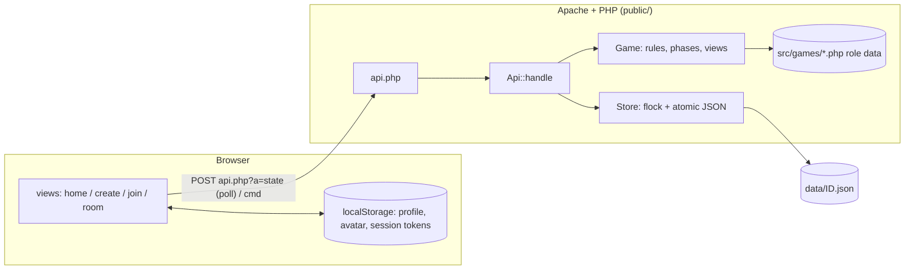

# Architecture

> Maintained by the `documenter` agent together with `docs/code.md`.

## Purpose and scope
Two turn-based social-deduction games, **Werewolf** and **Mafia**, played from any browser (phone-first). A host creates a game, picks how many of each character, shares a code / QR link, and when all seats are filled the server deals the character cards and acts as moderator. Rules: [`rules.md`](rules.md).

Out of scope: accounts, spectators, persistence beyond a day, i18n.

## Confirmed stack
| Concern | Decision |
|---|---|
| Server language | **PHP ≥ 8.2**, plain (no framework), `declare(strict_types=1)`, namespace `Wm` |
| Target hosting | **Apache shared hosting** (Apache + PHP-FPM, no long-running processes, no WebSockets) |
| Dependencies | **None at runtime.** `composer.json` only declares PSR-4 autoload and scripts; `src/bootstrap.php` has an equivalent autoloader so `composer install` is not required on the server |
| Database | **None.** One JSON file per game (see *Storage*); chosen over MySQL because games are short-lived and file locking is enough. Can be swapped by re-implementing `Store` |
| Frontend | Vanilla JS ES modules, no build step; `qrcode-generator` (MIT) vendored in `public/js/vendor/` |
| Realtime | **Short polling** (1.2–5 s) of `api.php?a=state`, version-based |
| Tests | Dependency-free runner: `php tests/run.php` |

## High-level design


Layers:
- **Entry** `public/api.php` – reads the request, calls `Api`, writes JSON.
- **API** `src/Api.php` – a pure `handle(action, input) → [status, payload]`, so tests call it without HTTP.
- **Domain** `src/Game.php` (+ `Player`, `Config`, `GameError`) – all rules. `src/games/*.php` are data-only game definitions registered in `src/Games.php`.
- **Persistence** `src/Store.php` – locking, atomic writes, id validation, sweeping.
- **Client** `public/js` – router, views, polling.

## Request lifecycle
1. **Create** – `create`: validate (`Config::normalize`, `Config::profile`), allocate a 6-char id (alphabet without look-alikes) by exclusively creating `data/ID.json`, add the creator as host player, return `{id, playerId, token}`.
2. **Join** – the QR / link opens `?join=ID`; `join` adds a player (lobby only, names unique, seats limited) and returns a secret `token`. The token is the only credential and is saved in `localStorage` so a refresh resumes the seat.
3. **Play** – the client polls `state {id, token, v}`; if nothing changed the server answers `{unchanged:true}` without taking a lock. Commands are sent with `cmd` and answered with the fresh state.
4. **End** – a win condition sets phase `ended` and reveals all roles. Files idle for 24 h are deleted when new games are created (`Store::sweep`).

### Lazy timers
There is no background process, so phase deadlines are absolute timestamps (`Game::$deadline`, ms). `Game::tick()` is called at the start of every locked request and advances expired phases (night actions missing → skipped, discussion → vote, vote → resolved, …). Consequence: if nobody polls, time effectively stands still; the first poll catches up one phase at a time (each new phase gets a fresh full timer).

### Versions and presence
Every visible change bumps `Game::$version`. A poll with the current version is answered from a lock-free read. Each poll also refreshes the player's `lastSeen` (at most every 5 s via the locked path); players unseen for 15 s are shown as disconnected.

## Storage
- `data/<ID>.json` – the whole game (settings, players incl. tokens and avatars, log, chat, night state). `data/<ID>.lock` – lock file.
- **Writers** take `flock(LOCK_EX)` on the lock file, load, `tick()`, apply the change, write a temp file and `rename()` it over the game file (atomic).
- **Readers** (`Store::peek`) are lock-free and always see a complete file.
- The directory is configured in `config/config.php` (`data_dir`; override in `config/config.local.php` or `WM_DATA_DIR`). It must be writable and, ideally, outside the web root; `data/.htaccess` denies access when inside it.
- Role/game definitions are code, not data.

## Game engine (`src/Game.php`)
```
lobby ─start→ discussion(day 0) ─→ night ─→ [hunter] ─→ discussion ─→ vote ─→ [hunter] ─→ night … ─→ ended
```
- Night has two steps: step 1 all actors in parallel; step 2 the Witch, who is told the evil team's victim. `resolveNight` is deterministic: blocks → victim/heal/poison/shot attacks → protection → inspections → deaths.
- Deaths go through `kill()` + `afterDeaths($next)` which handles `onDeath` roles (Hunter) before the win check.
- Randomness (`rng`) and time (`clock`) are injectable for tests.
- The engine reads capabilities from role definitions (`night.kind`, `onDeath`, `appearsAs`, `team`, `filler`), never role ids. Supported night kinds: `kill`, `inspect`, `protect`, `block`, `shoot`, `witch`.

## Cross-cutting concerns
- **Hidden information**: the only way client state is produced is `Game::viewFor($playerId)`. It includes another player's role only if allowed (self, dead with reveal on, evil teammates, everyone after the end). Chat is filtered by channel (`all`, `dead`, `evil`). Tokens and avatars never appear in views; avatars are fetched through the separate `avatars` action, only by authenticated players.
- **Validation**: every input is validated server-side (phase, aliveness, target legality, lengths, id regex `^[A-Z2-9]{6}$` against path traversal). Player mistakes throw `GameError` → HTTP 400 with the message; anything else → 500 with a generic message and `error_log`.
- **Auth**: random 128-bit token per player, compared with `hash_equals`; sent in the POST body (not in URLs/logs). No accounts, no cookies, hence no CSRF surface.
- **XSS**: all dynamic client text goes through `esc()`; avatars must match `data:image/(jpeg|png|webp);base64,…` ≤ 40 KB and are only used in ``.
- **Configuration/secrets**: none needed. `config/config.local.php` and `.env` are git-ignored.
- **Logging**: PHP `error_log` (the site's error log).
- **Avatars**: cropped/shrunk to 96×96 JPEG in the browser, stored in `localStorage`, uploaded on create/join.
- **QR codes**: the server owns the game id; the join link is built from the browser's current URL and rendered as QR client-side (no server image library needed).

## Directory layout
| Path | Role |
|---|---|
| `public/` | Web root: `index.html`, `api.php`, `css/`, `js/` |
| `src/` | PHP domain code (autoloaded as `Wm\`) |
| `src/games/` | Data-only game definitions |
| `config/` | Configuration |
| `data/` | Runtime game files (git-ignored, access denied) |
| `tests/` | Test runner and tests |
| `docs/` | Documentation |
| `.claude/` | Agentic feature workflow |

## Testing strategy
`php tests/run.php [filter]`. Engine tests drive `Game` directly with fixed roles, a mutable `Clock` and fixed `rng`; API tests call `Api::handle` against a temporary data directory (create/join/poll/commands/lazy timers/sweep).

## Key decisions
1. **PHP + polling instead of WebSockets** – shared hosting cannot keep processes alive. Cost: ≤1.2 s latency, one small request per player per poll.
2. **JSON files + flock instead of MySQL** – no schema/migrations, trivial deploy; fine for ≤30 players per game. Revisit if games must survive long or scale out to several servers.
3. **Server-authoritative moderator** – no human narrator; clients only receive filtered views.
4. **Lazy timers** – deadlines applied on the next request instead of cron/daemon.
5. **Data-driven roles** – new roles/games are mostly data (`src/games`).
6. **Client-side QR** – avoids Composer/GD on the server.
7. **Rules fixed to one variant** (plurality vote, no run-off, …) – see `rules.md`.

## Deployment
Upload the repository; set the domain's web directory to `public/` (or keep the repo as web root: the root `.htaccess` forwards to `public/`). Ensure PHP ≥ 8.2 for the domain, `data/` is writable (or point `data_dir` outside the web root in `config/config.local.php`). Use HTTPS. Details in the README.

## Open questions / limitations
- No spectators, no rejoin after being kicked, no per-game language.
- Presence is approximate (15 s). A game with no polling clients does not progress.
- Heavy concurrent use (many large games) would be better served by a real database.
